# James Muriithi

---

  

---

#---> :
class SecurityResearcher:     def __init__(self):         self.alias = "James Muriithi"         self.focus = ["Automation", "Offensive Security", "Exploit Dev"]         self.tools = ["Python", "JavaScript", "C++"]         self.objective = "Bridging the gap between automated systems and manual exploitation."      def mission_statement(self):         return "Turning vulnerabilities into documented findings through code."  # Offensive only when it matters.

---

---
## 🌐 Socials:
 

# Stack:
            

---
<!--
`[C]        ██████████░░ 90%`  
`[C#]       █████████░░░ 75%`  
`[C++]      ██████████░░ 85%`  
`[Java]     █████████░░░ 80%`  
`[JavaScript]███████████░ 95%`  
`[HTML5]    ██████████░░ 90%`  
`[CSS3]     █████████░░░ 85%`  
`[Python]   ███████░░░░░ 70%`  
`[Go]       ██████████░░ 90%`  
`[Bash]     ████████░░░░ 80%`  
`[Kotlin]   ██████░░░░░░ 50%`        
---
--->
---
🐧 
> "Talk is cheap. Show me the code." - Linus Torvalds

  

---

---

---

